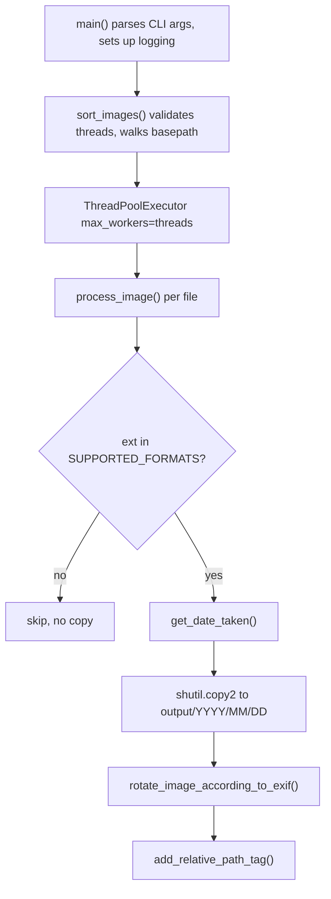

# Architecture Overview

`sortinfolder.py` is a deliberately small system: one Python module contains the entire program. There are no packages, no plugins, no configuration files, and no persistent state of its own — the filesystem is the only store, and source files are **copied** (`shutil.copy2`), never moved or deleted. Everything the program does is expressed through eight module-level functions, layered from a thin CLI entry point down to per-file processing.

For a hands-on introduction, see [Quickstart](../quickstart.md); the command-line surface is detailed in [CLI and Configuration](../operations/cli-and-configuration.md).

## Layering and control flow

The system has three layers:

1. **CLI layer — `main()`** parses arguments (`basepath`, `output_path`, `--log LEVEL`, `--threads N`, `--dry-run`), maps the `--log` string to a numeric logging level via `getattr(logging, args.log.upper(), None)` (raising `TypeError` for invalid names), calls `setup_logging()`, and invokes `sort_images()`. When `sort_images` reports `failure_count > 0`, `main()` exits with `sys.exit(1)`; a fully successful run exits 0.
2. **Orchestration layer — `sort_images(basepath, output_path, threads=30, dry_run=False)`** validates that `threads` is between 1 and 100 (raising `ValueError` otherwise), creates the output directory if missing, walks `basepath` recursively with `os.walk`, and submits one `process_image` future per file to a `concurrent.futures.ThreadPoolExecutor`. As futures complete, it counts successes and failures and collects error details (`file`, `type`, `message`) into a list, which it returns as `(success_count, failure_count, errors_list)`.
3. **Worker layer — `process_image(file_path, basepath, output_path, dry_run=False)`** performs all per-file work: format gating, date extraction, directory creation, collision handling, copying, rotation, and tagging.

Every per-file failure is caught in `sort_images` and logged; one corrupted file never aborts the run. This is verified end-to-end by `test_error_summary_and_exit_code` and `test_cli_exit_code_end_to_end` in `test_sortinfolder.py`.

*Caption: control flow from the CLI entry point through the thread pool down to the per-file pipeline of gate, date extraction, copy, rotation, and tagging.*

## Public functions

| Function | Role |
| --- | --- |
| `setup_logging(level)` | Configures the root logger with a thread-aware format (`%(asctime)s - [Thread %(thread)d] - %(levelname)s - %(message)s`). |
| `get_exif_orientation(img)` | Reads the EXIF `Orientation` tag from an open Pillow image; returns `None` on any attribute/key error or when EXIF is absent. |
| `rotate_image_according_to_exif(image_path)` | Re-opens the file, applies the rotation implied by `Orientation`, and saves back to the same path. |
| `get_date_taken(path)` | Extracts `EXIF DateTimeOriginal` via `exifread`; falls back to file ctime. |
| `add_relative_path_tag(image_path, relative_path)` | Appends `RelativePath:<relative_path>` to the EXIF `UserComment` of JPEGs using `piexif`. |
| `process_image(...)` | Per-file pipeline: gate, date, destination folder, collision suffix, copy, rotate, tag. |
| `sort_images(...)` | Orchestrates `os.walk` + thread pool, returns `(success_count, failure_count, errors_list)`. |
| `main()` | CLI entry point; exits 1 if any file failed. |

### Rotation semantics

`get_exif_orientation` returns the raw EXIF orientation value. Only three values trigger a rewrite: `3` rotates 180°, `6` rotates 270°, and `8` rotates 90° (all with `expand=True`, preserving the original EXIF data that Pillow retains across `rotate`). Rotation happens only after the file has been copied to its destination, so the source is never modified. In `--dry-run` mode, `process_image` instead reads orientation without touching anything and logs what it *would* rotate, including the angle.

### Date resolution and fallback

`get_date_taken` opens the file in binary mode and asks `exifread` to stop at `EXIF DateTimeOriginal`. If that tag parses as `%Y:%m:%d %H:%M:%S`, the resulting `datetime` drives the `%Y/%m/%d` folder structure. If the tag is missing, unreadable, or malformed (any `OSError`, `KeyError`, or `ValueError`), the function logs a warning and falls back to the file's creation time via `datetime.fromtimestamp(os.path.getctime(path))`. The EXIF side of this behavior is covered in detail on [EXIF and Metadata](../concepts/exif-and-metadata.md).

### Relative-path tagging

`add_relative_path_tag` computes `os.path.relpath(os.path.dirname(file_path), basepath)` and appends `RelativePath:<value>` to the JPEG's EXIF `UserComment` — so the original directory structure survives the reorganization even when filenames collide. Tagging is restricted to `.jpg`/`.jpeg` extensions: other supported formats (PNG, TIFF, HEIC, BMP, WebP) are copied and dated but never tagged, as asserted by `test_process_image_supports_multiple_formats`. Any `OSError` or `piexif.InvalidImageDataError` is re-raised, so a tagging failure counts as a file failure in the summary.

## The format gate

`SUPPORTED_FORMATS = {'.jpg', '.jpeg', '.png', '.heic', '.tiff', '.tif', '.bmp', '.webp'}` is the very first check `process_image` applies. The file extension is lowercased and compared against this set; anything else is logged at debug level and returned immediately, before any date lookup, copying, or EXIF work. This makes the set the single point of control for which file types the tool touches — adding a format is a one-line change to this constant, with no other code paths to update.

## Filename collision handling

Within a destination date folder, `process_image` keeps the original basename when it is free; on a collision it appends `_1`, `_2`, … until a free name is found, logging the collision at info level. Because two source directories can both contain `test.jpg` with different content, the suffixing guarantees both survive with distinct names — `test_process_image_handles_duplicate_filenames` verifies that `test.jpg` and `test_1.jpg` both land in `2024/06/15` with their original, differing pixel content preserved.

## Module importability and testing

The CI unit check is intentionally minimal: `.ci/ci.yaml` defines `unit.cmd` as `["python", "-c", "import sortinfolder"]` (executed without a shell), so the module merely needs to import cleanly inside the `python:3.12-slim` image with `Pillow`, `exifread`, and `piexif` installed (see `.ci/test.Dockerfile`). This is why `test_sortinfolder.py` imports functions directly (`from sortinfolder import process_image`, `from sortinfolder import sort_images`) for behavior tests, and only uses subprocesses for CLI-level tests (`--help` output, exit codes, `--dry-run`, invalid `--threads`). Module importability is the CI's compile-and-load gate; the function-level imports in tests mean any top-level side effect added to `sortinfolder.py` (e.g., running `main()` unconditionally) would break both the CI check and the test suite.

## External dependencies

Three third-party libraries divide the EXIF work:

- **Pillow** (`PIL`) — opens, decodes, rotates, and saves images; also supplies `ExifTags.TAGS` for orientation lookup. `UnidentifiedImageError` from Pillow signals undecodable files.
- **exifread** — read-only EXIF parsing used solely by `get_date_taken` for `EXIF DateTimeOriginal`.
- **piexif** — read/modify/write EXIF used solely by `add_relative_path_tag` to append the `RelativePath:` marker to `UserComment`.

Pillow and exifread read the file independently at different stages; there is no shared in-memory image object between date extraction, rotation, and tagging — each function re-opens the file from disk.

## State and persistence

There is no database, cache, config file, or in-memory index that survives a run. The only durable effect is the output tree `output_path/YYYY/MM/DD/<filename>` built via `os.makedirs` and `shutil.copy2`. Because `copy2` preserves metadata (including EXIF) and `rotate_image_according_to_exif` operates on the *destination* copy, the source tree is never mutated — a run can always be repeated safely, though re-running re-copies (and may re-suffix) files into the same output tree. The end-to-end pipeline is described in more depth in [Sorting Pipeline](../workflows/sorting-pipeline.md).
