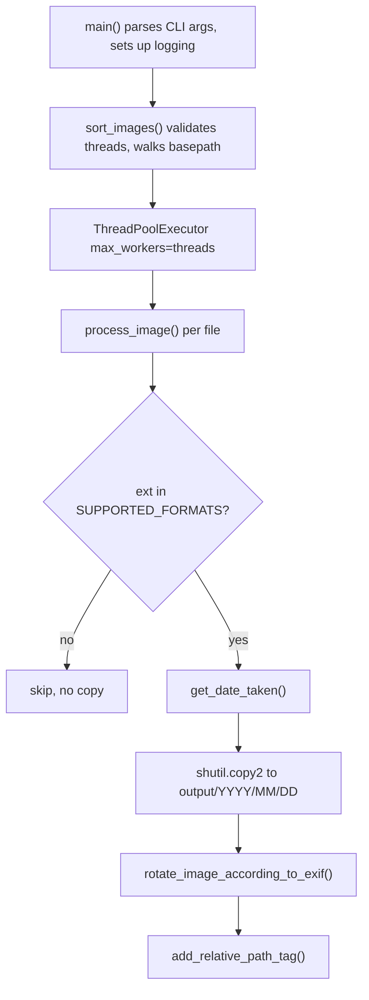

# Architecture Overview

`sortinfolder.py` is a deliberately small application: one Python module contains the entire sorter, with no package hierarchy or plugin system. Its business logic is expressed through eight module-level functions, layered from a thin CLI entry point down to per-file processing. The application has **no runtime configuration files**; its inputs and behavior are supplied through CLI arguments. The repository does contain separate agent-facing guidance and configuration in `AGENTS.md`, `.codex/config.toml`, `opencode.json`, and `.optio/setup.sh`, but those files do not configure the sorter at runtime; see [Agent Configuration](../operations/agent-configuration.md) for that distinction.

The application keeps no database, cache, or persistent in-memory index. Its durable runtime state is the filesystem: source files are copied with `shutil.copy2`, never moved or deleted, and metadata changes are applied to destination copies rather than the original inputs.

For a hands-on introduction, see [Quickstart](../quickstart.md); the command-line surface is detailed in [CLI and Configuration](../operations/cli-and-configuration.md).

## Layering and control flow

The system has three layers:

1. **CLI layer — `main()`** parses `basepath`, `output_path`, `--log LEVEL`, `--threads N`, and `--dry-run`; maps the `--log` string to a numeric logging level with `getattr(logging, args.log.upper(), None)` (raising `TypeError` for invalid names); calls `setup_logging()`; and invokes `sort_images()`. When `sort_images` reports `failure_count > 0`, `main()` exits with `sys.exit(1)`; a run with no worker failures exits 0.
2. **Orchestration layer — `sort_images(basepath, output_path, threads=30, dry_run=False)`** validates that `threads` is between 1 and 100 (raising `ValueError` otherwise), creates the output directory if missing, walks `basepath` recursively with `os.walk`, and submits one `process_image` future per discovered file to a `concurrent.futures.ThreadPoolExecutor`. As futures complete, it counts successes and failures and collects error details (`file`, `type`, `message`) into a list, which it returns as `(success_count, failure_count, errors_list)`.
3. **Worker layer — `process_image(file_path, basepath, output_path, dry_run=False)`** performs all per-file work: format gating, date extraction, directory creation, collision handling, copying, rotation, and tagging.

Worker exceptions are caught in `sort_images` and logged, so one corrupted file does not abort the run. This behavior is verified end to end by `test_error_summary_and_exit_code` and `test_cli_exit_code_end_to_end` in `test_sortinfolder.py`.

*Caption: control flow from the CLI entry point through the thread pool down to the per-file pipeline of gate, date extraction, copy, rotation, and tagging.*

## Public function surface

| Function | Role |
| --- | --- |
| `setup_logging(level)` | Configures the root logger with a thread-aware format (`%(asctime)s - [Thread %(thread)d] - %(levelname)s - %(message)s`). |
| `get_exif_orientation(img)` | Reads the raw EXIF `Orientation` value from an open Pillow image; returns `None` if EXIF is absent or an `AttributeError`, `KeyError`, `IndexError`, or `TypeError` occurs. |
| `rotate_image_according_to_exif(image_path)` | Re-opens an image and, for orientation values 3, 6, or 8, rotates and saves it back to the same path. |
| `get_date_taken(path)` | Extracts `EXIF DateTimeOriginal` via `exifread`; falls back to the file's `ctime`. |
| `add_relative_path_tag(image_path, relative_path)` | Appends `RelativePath:<relative_path>` to the EXIF `UserComment` of JPEGs using `piexif`. |
| `process_image(...)` | Per-file pipeline: gate, date, destination folder, collision suffix, copy, rotate, tag. |
| `sort_images(...)` | Orchestrates `os.walk` plus a thread pool and returns `(success_count, failure_count, errors_list)`. |
| `main()` | CLI entry point; exits 1 if any worker failed. |

### Rotation semantics

`get_exif_orientation` returns the raw EXIF orientation value. Only three values trigger a rewrite: `3` rotates 180°, `6` rotates 270°, and `8` rotates 90° (all with `expand=True`). Rotation happens only after the file has been copied to its destination, so the source input is never modified. In `--dry-run` mode, `process_image` instead reads orientation from the source without touching it and logs what it *would* rotate, including the angle.

The module does not explicitly copy, restore, or strip EXIF around Pillow's rotate-and-save rewrite. It therefore relies on Pillow's library behavior if metadata is to survive that rewrite; the repository has no test that establishes orientation-metadata retention, so this is an implementation dependency rather than a tested application invariant. If `img.load()` reports truncated data, the function logs the condition and returns without rotating. Other decode failures are re-raised and become per-file failures.

### Date resolution and fallback

`get_date_taken` opens the file in binary mode and asks `exifread` to stop at `EXIF DateTimeOriginal`. If that tag parses as `%Y:%m:%d %H:%M:%S`, the resulting `datetime` drives the `%Y/%m/%d` folder structure. If the tag is missing, unreadable, or malformed (any `OSError`, `KeyError`, or `ValueError`), the function logs a warning and falls back to the file's `ctime` via `datetime.fromtimestamp(os.path.getctime(path))`. The EXIF side of this behavior is covered in detail on [EXIF and Metadata](../concepts/exif-and-metadata.md).

### Relative-path tagging

`process_image` computes the provenance value as `os.path.relpath(os.path.dirname(file_path), basepath)` and passes it to `add_relative_path_tag`. That function appends `RelativePath:<value>` to the JPEG's EXIF `UserComment`, so the original directory structure survives the reorganization even when filenames collide. Tagging is restricted to `.jpg`/`.jpeg` extensions: other supported formats (PNG, TIFF, HEIC, BMP, WebP) are copied and dated but never tagged, as asserted by `test_process_image_supports_multiple_formats`. `OSError`, `piexif.InvalidImageDataError`, and `struct.error` are logged and re-raised, so a tagging failure counts as a file failure in the summary.

## The format gate

`SUPPORTED_FORMATS = {'.jpg', '.jpeg', '.png', '.heic', '.tiff', '.tif', '.bmp', '.webp'}` is the very first check `process_image` applies. The file extension is lowercased and compared against this set; anything else is logged at debug level and returned immediately, before any date lookup, copying, or EXIF work.

The constant is the **admission boundary** for the shared pipeline, not a guarantee of equivalent format support. Adding an extension admits that file to the same copy and date-folder flow, but decoding still depends on Pillow's available codecs, orientation lookup depends on whether the image exposes EXIF, and `RelativePath` tagging remains JPEG-only. In particular, the repository does not install a dedicated HEIC decoder dependency, so `.heic` membership should not be read as a tested HEIC-decoding guarantee. The focused format test exercises JPEG, PNG, and TIFF rather than every member of the set.

A file outside the set still reaches `process_image` through the orchestrator and returns normally. Because a normally completed future is counted as a success, unsupported files increase the reported success count even though no output file was created.

## Filename collision handling

Within a destination date folder, `process_image` keeps the original basename when it is free; on a collision it appends `_1`, `_2`, … until a free name is found, logging the collision at info level. `test_process_image_handles_duplicate_filenames` calls `process_image` sequentially and verifies that two same-named files with different content become `test.jpg` and `test_1.jpg` in `2024/06/15` with their original, differing pixel content preserved.

That suffix rule is not a concurrency guarantee. Date-folder creation is a check followed by `os.makedirs`, and name selection is a check followed by `copy2`; neither operation is coordinated between workers. Concurrent files with the same destination name are therefore not guaranteed to receive distinct suffixes. The application has no lock, reservation, or deduplication mechanism, and its tests do not exercise this race.

## Module importability and focused tests

The CI unit check is intentionally minimal: `.ci/ci.yaml` defines `unit.cmd` as `["python", "-c", "import sortinfolder"]` (executed without a shell), so the module merely needs to import cleanly inside the `python:3.12-slim` image with `Pillow`, `exifread`, and `piexif` installed (see `.ci/test.Dockerfile`). Importability is therefore an application invariant: the module's top level defines imports, the format constant, a logger, and functions, while the CLI invocation is guarded by `if __name__ == "__main__": main()`. Import-time work that failed or caused side effects would violate this invariant and could fail the CI gate or direct-import tests.

`test_sortinfolder.py` imports `process_image` and `sort_images` directly for behavior tests and uses subprocesses for CLI-level tests. Its focused coverage includes sequential duplicate names, the JPEG/PNG/TIFF boundary and JPEG-only tagging, dry-run behavior, invalid thread bounds, per-file error aggregation, and both CLI exit-code branches. It does not cover concurrent collision races or retention of orientation metadata through rotation.

## External dependencies

Three third-party libraries divide the image and EXIF work:

- **Pillow** (`PIL`) — opens, decodes, rotates, and saves images; also supplies `ExifTags.TAGS` for orientation lookup. `UnidentifiedImageError` from Pillow signals undecodable files.
- **exifread** — read-only EXIF parsing used solely by `get_date_taken` for `EXIF DateTimeOriginal`.
- **piexif** — read/modify/write EXIF used solely by `add_relative_path_tag` to append the `RelativePath:` marker to `UserComment`.

Pillow and exifread read the file independently at different stages; there is no shared in-memory image object between date extraction, rotation, and tagging—each function re-opens the file from disk.

## State and persistence

The application has no database, cache, runtime config file, or in-memory index that survives a run. The durable result is the output tree `output_path/YYYY/MM/DD/<filename>`, built via `os.makedirs` and `shutil.copy2`. The initial copy preserves source file metadata, and rotation and tagging operate on the destination path, so the input files themselves are not mutated.

The operation is additive rather than idempotent: re-running against a populated output tree copies the inputs again and normally receives numeric suffixes instead of updating the existing copies. The application does not validate that `output_path` is separate from `basepath`; an overlapping output location can therefore add generated files beneath the source tree. Neither case deletes source files. The end-to-end pipeline is described in more depth in [Sorting Pipeline](../workflows/sorting-pipeline.md).
