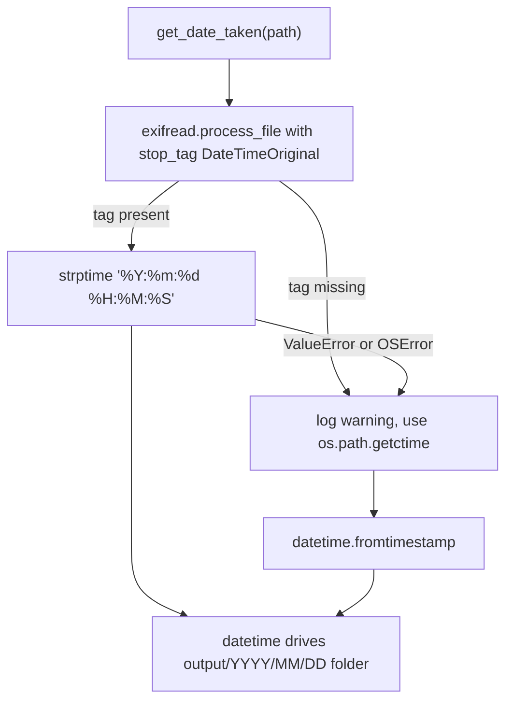
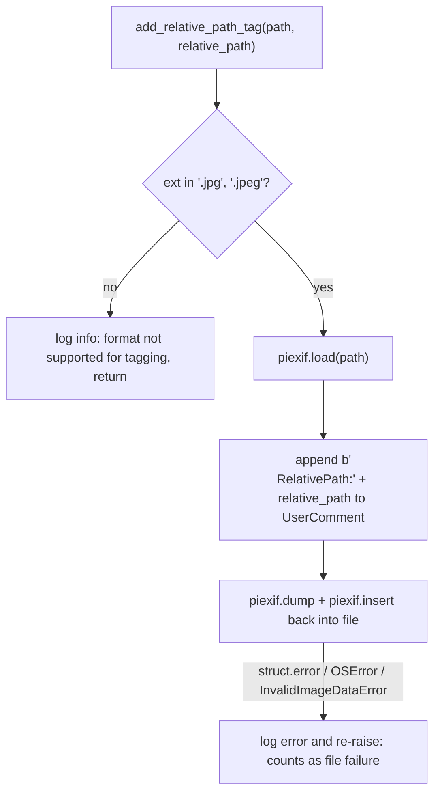

# EXIF and Metadata

`sortinfolder.py` uses EXIF metadata for two independent decisions and one side effect:

1. **Where a file goes** — the `EXIF DateTimeOriginal` timestamp drives the `<year>/<month>/<day>` output tree (with a file-ctime fallback).
2. **What a file looks like** — the `EXIF Orientation` tag determines whether the copied file is rotated in place.
3. **A provenance record** — the source directory path is appended to the copy's EXIF `UserComment` as a `RelativePath:` tag, so the original folder structure survives the reorganization.

These responsibilities live in three module-level functions — `get_exif_orientation` / `rotate_image_according_to_exif` (Pillow), `get_date_taken` (exifread), and `add_relative_path_tag` (piexif) — and each function re-opens the file from disk; there is no shared in-memory EXIF object between them. The overall pipeline that calls them is described in [Sorting Pipeline](../workflows/sorting-pipeline.md) and [Architecture Overview](../architecture/overview.md).

## Date resolution: `get_date_taken` and its fallback chain

`get_date_taken(path)` resolves the capture date with a two-step chain:

1. **EXIF first.** The file is opened in binary mode and parsed with `exifread.process_file(f, stop_tag="EXIF DateTimeOriginal")`. If the `EXIF DateTimeOriginal` tag is present, its string form (e.g. `2024:06:15 10:30:00`) is parsed with `datetime.strptime(date_str, '%Y:%m:%d %H:%M:%S')` and returned. The `stop_tag` argument makes exifread stop parsing once it has that tag, so only the needed portion of the metadata is decoded.
2. **ctime fallback.** Any `OSError` (unreadable file), `KeyError` (tag absent), or `ValueError` (unparseable date string) during step 1 is caught, a warning is logged (`"EXIF DateTimeOriginal not found in <path>. Using file creation date: ..."`) and the file's creation time is returned as `datetime.fromtimestamp(os.path.getctime(path))`.

The important failure semantics: **`get_date_taken` never raises for missing or malformed EXIF** — the fallback always produces a `datetime`, so every supported-format file lands in some date folder even when it has no usable EXIF. Note that the function's docstring claims it "raises `KeyError` if the tag is not found", which is inaccurate at runtime: the `KeyError` is raised internally precisely to be swallowed by the fallback handler.



*Caption: the two-step date resolution — EXIF `DateTimeOriginal` with a `%Y:%m:%d %H:%M:%S` parse, falling back to file creation time on any `OSError`, `KeyError`, or `ValueError`.*

`test_process_image_supports_multiple_formats` in `test_sortinfolder.py` exercises both branches: a JPG and a TIFF carry a real `DateTimeOriginal` and land in `2024/06/15`, while an EXIF-less PNG is still copied but falls back to its file creation date (so it may land in a different, ctime-derived folder).

## Orientation: `get_exif_orientation` and rotation semantics

`get_exif_orientation(img)` takes an already-open Pillow image and reads the raw `Orientation` tag:

- It calls `img._getexif()` — Pillow's private EXIF accessor. If the image carries no EXIF block, `_getexif()` returns `None` and the function returns `None` without logging anything beyond that.
- It scans `PIL.ExifTags.TAGS` for the numeric id whose name is `'Orientation'` (tag 274) and returns `exif[orientation]` — the raw integer orientation value.
- Any `AttributeError`, `KeyError`, `IndexError`, or `TypeError` is **swallowed**: the error is logged at debug level and `None` is returned. This makes the function total — it always returns the orientation value or `None`, never raising on its own for absent metadata.

`rotate_image_according_to_exif(image_path)` then applies the rotation. Only three orientation values trigger a rewrite, and the angle is *not* the tag value itself:

| Orientation tag | Applied rotation | Meaning |
| --- | --- | --- |
| `3` | `img.rotate(180, expand=True)` | image is stored upside-down |
| `6` | `img.rotate(270, expand=True)` | image is stored rotated 90° CW |
| `8` | `img.rotate(90, expand=True)` | image is stored rotated 90° CCW |

All other values (including `1` = already upright and `None` = no orientation data) result in a debug log and no save at all — the file is only re-saved (`img.save(image_path)`, in place) when orientation is `3`, `6`, or `8`. All rotations use `expand=True`, so the canvas grows to fit the rotated pixels instead of clipping corners.

The function's own error handling distinguishes two failure classes:

- **Truncated image data** — an inner `try: img.load()` catches `OSError`, logs `"Image file is truncated: <path>"`, and returns without raising. A partially readable file therefore counts as *processed* (it was already copied), it just is not rotated.
- **Undecodable / structurally invalid files** — a bare `OSError` from `Image.open` is re-raised as-is, and `UnidentifiedImageError` or `struct.error` are logged (`"Error in rotating image <path>: ..."`) and then re-raised. In the `sort_images` orchestration these failures are caught per-file, counted, and reported in the error summary — see [Architecture Overview](../architecture/overview.md#state-and-persistence) for how failures roll up.

`--dry-run` mode uses the read-only half of this machinery: `process_image` opens the *source* file, calls `get_exif_orientation`, and logs `"DRY RUN: Would rotate image <path> by <angle> degrees"` (or `"No rotation needed"`) without copying or modifying anything. A failure to open the source during dry-run is only a warning, not a counted failure.

## Provenance tagging: `add_relative_path_tag` (JPEG only)

`add_relative_path_tag(image_path, relative_path)` records where the file came from, using `piexif`:

1. The extension is checked first. Only `.jpg` and `.jpeg` are tagged. Any other extension logs `"File format not supported for tagging: <path>"` at info level and returns — the file is left untouched.
2. For JPEGs, the existing EXIF block is loaded with `piexif.load(image_path)`, and the `Exif` IFD's `UserComment` is read (defaulting to an empty `bytes` if absent).
3. The new value is `user_comment + b"\nRelativePath:" + relative_path.encode()` — i.e. a newline followed by the literal marker `RelativePath:` and the encoded relative path, **appended** to whatever the comment already contained. The relative path is computed by the caller (`process_image`) as `os.path.relpath(os.path.dirname(file_path), basepath)`, so repeated runs that append to the same copy would stack multiple `RelativePath:` lines.
4. The modified dictionary is serialized with `piexif.dump` and written back into the file with `piexif.insert(exif_bytes, image_path)`.

Error semantics: a `struct.error` from `piexif.dump`/`insert` is logged (`"Struct error while processing EXIF data in <path>"`) and re-raised, and `OSError` or `piexif.InvalidImageDataError` from `piexif.load` are also logged and re-raised. Tagging failures therefore count as per-file failures in the run summary rather than being silently ignored.

`test_process_image_supports_multiple_formats` pins this boundary down: the copied JPG is verified to contain `b"RelativePath:"` in its EXIF `UserComment`, while the copied TIFF is verified to exist without any such tag.



*Caption: the JPEG-only tagging gate — non-JPEG formats return untouched; JPEG tagging failures are re-raised and recorded as file failures.*

## README vs. code: which formats are actually affected

The README states *"The script is designed for JPEG images"*, but the code is broader. `process_image` gates on

```python
SUPPORTED_FORMATS = {'.jpg', '.jpeg', '.png', '.heic', '.tiff', '.tif', '.bmp', '.webp'}
```

so PNG, HEIC, TIFF, BMP, and WebP files are **sorted, dated, copied, and dated-folder-resolved** like JPEGs. The README's claim is true only of the *metadata-sensitive* steps, which behave differently per format:

- **Tagging is strictly JPEG-only** (`.jpg`/`.jpeg` extension check inside `add_relative_path_tag`), regardless of `SUPPORTED_FORMATS`.
- **Rotation depends on Pillow's `_getexif()`**, which is implemented for JPEG and TIFF-style images. For formats where `_getexif()` returns nothing or raises, `get_exif_orientation` swallows the failure and returns `None`, so those files are simply never rotated — a missing orientation is indistinguishable from an unsupported format.
- **Date extraction via exifread** works wherever exifread can parse EXIF (JPEG, TIFF); formats without readable EXIF fall back to ctime, as described above.

This means for a PNG or HEIC file the pipeline is effectively: sort by ctime (or whatever EXIF exifread finds) → copy → no rotation, no tag. The format gate itself is documented in [Architecture Overview](../architecture/overview.md#the-format-gate), and the behavior-level tests live in [Test Suite](../testing/test-suite.md).

## How the pieces compose

Within `process_image`, the EXIF work happens in a fixed order on the **destination copy** (the source tree is never mutated, since `shutil.copy2` preserves file metadata including EXIF):

1. `get_date_taken(file_path)` on the **source** — decides the destination folder.
2. `shutil.copy2` to `output/YYYY/MM/DD/<name>` (with `_1`, `_2`, … suffixing on collisions).
3. `rotate_image_according_to_exif(new_file_path)` on the **copy** — re-saves in place if orientation is 3, 6, or 8.
4. `add_relative_path_tag(new_file_path, relative_path)` on the **copy** — appends the provenance marker to `UserComment`.

The order matters: rotation rewrites the file first, and tagging then reads and rewrites the EXIF block on the rotated file, so both operations survive into the final artifact. If rotation were skipped (truncated data, no orientation, unsupported format), tagging still runs on the plain copy.
