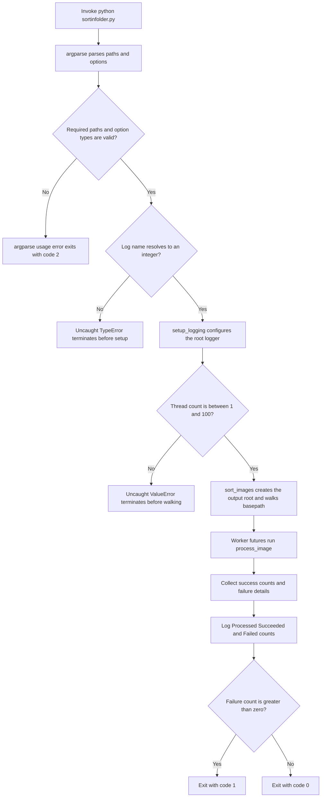

# CLI, Configuration, and Operations

`sortinfolder.py` is operated entirely from the command line. It has no configuration file, environment-variable input, daemon, or persistent state: every run is controlled by the arguments passed to `main()`. The runtime choices are the source and output directories, logging level, worker-thread count, and whether to simulate instead of copy.

## The command line

```
python sortinfolder.py [basepath] [output_path] [--log LEVEL] [--threads N] [--dry-run]
```

The parser uses `prog="sortimages"`, even though the file is invoked as `sortinfolder.py`, and its help text includes three examples:

```
sortimages /data/photos /data/sorted
sortimages /data/photos /data/sorted --log DEBUG
sortimages /data/photos /data/sorted --threads 5 --dry-run
```

| Argument | Type | Default | Meaning |
| --- | --- | --- | --- |
| `basepath` (positional) | str | — | Directory tree to scan for files. |
| `output_path` (positional) | str | — | Root of the generated output tree. |
| `--log` | str | `INFO` | Logging level name. |
| `--threads` | int | `30` | Maximum worker-thread count; the accepted range is 1–100. |
| `--dry-run` | flag | `False` | Plan the run without copying or modifying image files. |

Both positional paths are required. A missing positional path, an unknown option, or a non-integer `--threads` value is rejected by `argparse` before the processing body runs. `test_help_shows_usage_and_examples` verifies that help contains `usage: sortimages`, `options:`, and the examples section.

## Validation is split between two layers

`main()` and `sort_images()` enforce different rules at different times.

### Log level: validated in `main()`

Immediately after parsing, `main()` converts the value to uppercase and resolves it with:

```
numeric_level = getattr(logging, args.log.upper(), None)
```

If the result is not an integer, `main()` raises `TypeError(f"Invalid log level: {args.log}")`. This happens before `setup_logging()` and before `sort_images()`, so no output root is created and no source file is scanned. The intended accepted names include `DEBUG`, `INFO`, `WARNING`, `WARN`, `ERROR`, `FATAL`, `CRITICAL`, and `NOTSET`. A module-prefixed spelling such as `logging.DEBUG` is not accepted because the lookup does not include the `logging.` prefix.

### Thread count: validated in `sort_images()`

`main()` does not check the thread range. It passes the parsed integer to `sort_images(basepath, output_path, threads=args.threads, dry_run=args.dry_run)`, whose first operation is:

```
if not 1 <= threads <= 100:
    raise ValueError(f"threads must be between 1 and 100, got {threads}")
```

Consequently, an out-of-range count fails inside the orchestration layer. `test_cli_invalid_threads_value` runs the CLI in subprocesses with `--threads 0` and `--threads 101` and verifies a non-zero status and an error mentioning threads. Because validation precedes directory creation, an invalid thread count does not create `output_path`.

### Paths: no path-level validation

There is no check that either path exists and no comparison between the source and output paths. A nonexistent `basepath` makes `os.walk(basepath)` yield no files, producing an empty run after the output root is created. A nonexistent `output_path` is created with `os.makedirs(output_path)` before any work is submitted.

## Exit and termination behavior

There are three distinct status paths; they should not be collapsed into a single “success versus failure” rule.

| Situation | Observed process status | Boundary reached |
| --- | --- | --- |
| Argparse usage or option-type error | 2 | Argparse rejects the command line before the processing body. |
| Invalid log name or invalid thread count | Non-zero, normally Python's exception status 1, with a traceback | An uncaught `TypeError` or `ValueError` terminates the run before orchestration. |
| Normal run with no worker failures | 0 | `main()` returns normally. |
| Normal run with one or more worker failures | 1 | `main()` calls `sys.exit(1)`. |

After `sort_images()` returns, the explicit aggregate rule in `main()` is simple: `sys.exit(1)` is called if and only if `failure_count > 0`; otherwise `main()` falls through and the interpreter exits 0. The subprocess tests verify the two aggregate outcomes in `test_cli_exit_code_end_to_end`: a run containing one valid image and one corrupted image exits 1 and reports `Processed: 2`, `Failed: 1`, while a run containing only a valid image exits 0 and reports `Processed: 1`, `Failed: 0`.

Per-file worker exceptions do not abort the run. `sort_images()` catches every `Exception` raised by a future, adds a record containing `file`, `type`, and `message` to `errors_list`, logs the error, and continues consuming completed futures. It always logs `Processed: N, Succeeded: N, Failed: N` after the worker phase and returns `(success_count, failure_count, errors_list)`. `test_error_summary_and_exit_code` checks that structure directly and confirms that the valid image is still processed when a neighboring file fails.

Two operational details matter when interpreting those counts:

- Every regular file discovered under `basepath` is submitted to `process_image`, regardless of extension. An unsupported extension is logged at debug level and returns normally, so it is counted as a success even though it produces no output image. `Processed` and `Succeeded` therefore describe submitted files, not the number of generated images.
- Copying happens before rotation and tagging. If a later step fails, the already-copied destination is not rolled back, while the source file is counted as a failure.

## Logging

`setup_logging(level)` makes one `logging.basicConfig` call with the format:

```
%(asctime)s - [Thread %(thread)d] - %(levelname)s - %(message)s
```

The thread field makes concurrent output attributable to the worker that emitted it. In a normal CLI process, the default `basicConfig` stream is stderr, so operational logs are separated from stdout. If the module is embedded in an application that already configured the root logger, `basicConfig` does not replace that existing configuration.

The implementation uses levels as follows:

| Level | Relevant output |
| --- | --- |
| `DEBUG` | Unsupported-format skips, file-processing diagnostics, EXIF orientation lookup, rotation decisions, extracted EXIF dates, and missing-orientation details. |
| `INFO` | Argument echo, dry-run banner, directory creation, collision notices, each copy, unsupported tagging notice, and the final `Processed`, `Succeeded`, and `Failed` summary. |
| `WARNING` | EXIF `DateTimeOriginal` fallback to file creation time and a dry-run rotation check that could not open the image. |
| `ERROR` | Per-file worker failures, truncated-image reports, rotation errors, EXIF struct errors, and other image or tagging failures. |
| `CRITICAL` | Accepted as a level, but the implementation does not emit critical messages. Selecting it suppresses normal operational output. |

The default `INFO` level retains the per-file copy records and final summary while omitting the noisier image-inspection diagnostics.

## Dry-run mode

`--dry-run` turns `process_image` into a planning path. It does not copy, rotate, or tag image files, and it does not create the date-specific destination folders.

1. `sort_images()` still creates the top-level `output_path` if it is missing and logs `DRY RUN MODE - Simulating processing without copying files`.
2. Date extraction still runs, so the planned `YYYY/MM/DD` destination is calculated, but the date directory is not created.
3. The worker logs `DRY RUN: Would copy <source> to <destination>`, including the numeric suffix it would use for an existing destination name.
4. It opens the source read-only to inspect EXIF orientation, then logs the planned rotation angle or `DRY RUN: No rotation needed for ...`.
5. For destinations whose extension is `.jpg` or `.jpeg`, it logs the planned `RelativePath` tag. Other formats log that tagging would be skipped.

If the dry-run orientation check cannot open an image, the worker logs `DRY RUN: Could not check rotation for ...` at warning level and continues. That degradation does not count as a file failure, so a dry run can exit 0 even for an image that the real copy-and-rotate path would reject.

`test_cli_threads_and_dry_run` exercises `--threads 5 --dry-run` end to end. It verifies exit 0, the presence of `DRY RUN`, the planned date folder and filename in the log, and zero files in the output tree. The top-level output directory may nevertheless exist because `sort_images()` creates it before work is submitted.

## Operational safety model: additive and copy-only

The README advises, *"Make sure to back up your images before processing."* The intended safety model is that original image files are not edited: `process_image()` copies the source with `shutil.copy2`, then applies orientation correction and `RelativePath` tagging only to the copied destination.

The output tree is additive:

- There is no content-based deduplication and no intentional overwrite of an existing destination. When the destination name already exists, the code selects `name_1.ext`, `name_2.ext`, and so on; re-running against an existing output therefore creates numeric suffixes rather than replacing earlier results.
- `shutil.copy2` preserves metadata at the moment of copying. Later rotation or tagging edits the destination and can change file metadata, so the final file should not be assumed to retain every original timestamp.
- There is no rollback if a post-copy step fails. The destination artifact can remain even though that source file is counted as a failure and contributes to exit status 1.
- The code does not detect an `output_path` nested inside `basepath`. A later scan can discover earlier output files under the source tree and process them again, so the two trees should be distinct and non-overlapping.

## CI container

Continuous integration is defined by two small files:

- **`.ci/test.Dockerfile`** starts from `python:3.12-slim`, installs `Pillow`, `exifread`, and `piexif` with `pip install --no-cache-dir Pillow exifread piexif`, and sets `WORKDIR /workspace`. It installs no other system packages or test tooling.
- **`.ci/ci.yaml`** points `image.dockerfile` at `.ci/test.Dockerfile` and defines one `unit` check whose `cmd` is `["python", "-c", "import sortinfolder"]`. The command is a shell-less argument array.

The unit job therefore only imports the module; it does **not** run `pytest` or execute the behavioral test file. Its gate is that `sortinfolder` compiles and imports in the Python 3.12 slim image with the three dependencies available. The `if __name__ == "__main__": main()` guard prevents the import from starting a sort. The separate behavioral coverage is described in [Test Suite](../testing/test-suite.md).

## End-to-end operational flow



*Caption: From CLI invocation to exit status, including argparse rejection, the two-layer validation split, worker error aggregation, and the final exit rule.*

## Related pages

- Getting started and installation: [Quickstart](../quickstart.md)
- How the sorting, rotation, and tagging pipeline works: [Sorting Pipeline](../workflows/sorting-pipeline.md)
- System structure and layering: [Architecture Overview](../architecture/overview.md)
- Behavioral tests behind the guarantees above: [Test Suite](../testing/test-suite.md)
