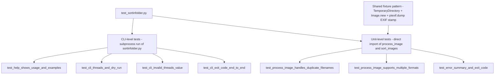

# Test Suite

`test_sortinfolder.py` is the entire automated test surface of this repository. It is a single pytest file with seven tests that cover the program from two levels: CLI-level tests that run `sortinfolder.py` as a subprocess and assert on exit codes, log output, and `--help` text, and unit-level tests that import functions from the module directly and assert on filesystem side effects. Both styles share one fixture pattern: disposable directories created with `tempfile.TemporaryDirectory`, and EXIF-stamped images generated on the fly with Pillow and `piexif`.

For how the tested functions behave at runtime, see [Architecture Overview](../architecture/overview.md) and [Sorting Pipeline](../workflows/sorting-pipeline.md); the CLI surface the tests exercise is documented in [CLI and Configuration](../operations/cli-and-configuration.md).



*Caption: the seven tests split into CLI-level subprocess tests and unit-level direct-import tests, both fed by the shared TemporaryDirectory + piexif fixture pattern.*

## How to run the suite

**Locally:** install the three runtime dependencies — `Pillow`, `exifread`, and `piexif` (the same list as in the README's Requirements section) — and run:

```
pytest test_sortinfolder.py
```

**Standalone:** the file also runs without pytest. Its `__main__` block calls each test function in sequence and prints a `passed` line after each one, so `python test_sortinfolder.py` works as a smoke runner in environments where pytest is not installed.

**In CI:** see [How CI runs them](#how-ci-runs-them) below.

## The shared fixture pattern

There is no pytest fixture function or conftest; instead, every test builds its world inline with the same three ingredients:

1. **Disposable directories.** Each test wraps its work in `with tempfile.TemporaryDirectory() as tmpdir:` and creates a `source` basepath and an `output` path inside it. Subdirectories (e.g. `sub1/` and `sub2/` for the duplicate-filename test) are created with `os.makedirs`. Everything is removed automatically when the block exits, so tests never pollute the working tree and can run in parallel or repeatedly.

2. **EXIF-stamped images generated in code.** Test images are created with `PIL.Image.new('RGB', (100, 100), color=...)` and saved with an EXIF dictionary that pins `piexif.ExifIFD.DateTimeOriginal` to `"2024:06:15 10:30:00"`. `piexif.dump(exif_dict)` serializes the dictionary, and the bytes are passed to `img.save(path, "JPEG", exif=exif_bytes)`. This gives every test a deterministic, known EXIF date — the tests never depend on real camera data or the machine's clock, and the expected destination folder is always `output/2024/06/15`.

3. **Content assertions at the pixel level.** Because Pillow's named colors can be quantized during JPEG encoding (the test comments note that PIL 'red' may encode as 254, not 255), the tests do not compare checksums of encoded output. Instead they re-open the copied images and assert on pixel values with tolerant thresholds, e.g. `r1 > 200 and g1 < 50 and b1 < 50` for the red image and the mirrored bound for the blue one. One test additionally compares MD5 checksums of two output files only to prove they *differ*, which is safe because it asserts inequality, not exact bytes. Together these assertions verify that `process_image` preserves image content through copy, rotation, and tagging.

PNG files are created without EXIF (Pillow does not write EXIF for PNG via this API), which is deliberate: that test specifically exercises the [EXIF fallback to file creation time](../concepts/exif-and-metadata.md) while asserting the file is still copied.

## The seven tests and their invariants

| Test | Level | Invariant proven |
| --- | --- | --- |
| `test_help_shows_usage_and_examples` | CLI (subprocess) | `--help` exits successfully and prints argparse output containing `usage: sortimages`, `options:`, and an `Examples:` section. |
| `test_process_image_handles_duplicate_filenames` | Unit (import) | Two source files named `test.jpg` in different subfolders with identical EXIF dates land in the same `2024/06/15` folder as `test.jpg` and `test_1.jpg`, with differing checksums and their original red/blue pixel content preserved. |
| `test_process_image_supports_multiple_formats` | Unit (import) | JPG, PNG, and TIFF files are all processed: EXIF-dated JPG and TIFF land in `2024/06/15`, EXIF-less PNG is still copied (falling back to ctime), the JPG gains a `RelativePath:` entry in its EXIF `UserComment`, and the TIFF is copied without being tagged. |
| `test_cli_threads_and_dry_run` | CLI (subprocess) | `--threads 5 --dry-run` exits 0, prints `DRY RUN` messages including the target date folder and filename, and copies nothing — the output directory stays empty. |
| `test_cli_invalid_threads_value` | CLI (subprocess) | `--threads 0` and `--threads 101` both produce a non-zero exit code and output mentioning threads. |
| `test_error_summary_and_exit_code` | Unit (import) | `sort_images` returns the `(success_count, failure_count, errors_list)` tuple; a corrupted file yields a structured error dict (`file`, `type`, `message`), the summary line reports `Processed: 2, Succeeded: 1, Failed: 1`, and the valid image is still processed despite the failure. |
| `test_cli_exit_code_end_to_end` | CLI (subprocess) | End-to-end exit-code contract: a run containing one corrupted file exits 1 with `Failed: 1` / `Processed: 2` in the output; a run with only valid files exits 0 with `Failed: 0` / `Processed: 1` and the image copied to `2024/06/15`. |

### test_help_shows_usage_and_examples

Runs `[sys.executable, "sortinfolder.py", "--help"]` with `check=True` and asserts the argparse help text contains `usage: sortimages`, `options:`, and `Examples:`. This proves the parser is built with `prog="sortimages"` and a raw-description epilog containing the three usage examples — the help text is treated as part of the tool's contract, so renaming the program or dropping the examples would fail CI.

### test_process_image_handles_duplicate_filenames

Creates two 100×100 JPEGs with the *same* name (`test.jpg`) but *different* pixel content (red vs. blue) in `sub1/` and `sub2/`, both stamped with the same EXIF date, so they must compete for the same destination path `output/2024/06/15/test.jpg`. It then imports and calls `process_image` directly for each file and asserts that the first keeps its name, the second receives the `_1` suffix, and both output files have different MD5 checksums. Finally it verifies content preservation with pixel-color assertions at the image center. This is the only test that directly proves the collision-suffixing `while os.path.exists(new_file_path)` loop in `process_image`.

### test_process_image_supports_multiple_formats

Creates one JPG (EXIF-stamped), one PNG (deliberately without EXIF), and one TIFF (EXIF-stamped), processes all three via direct `process_image` calls, and asserts:

- The JPG and TIFF are copied into `output/2024/06/15/` (their EXIF `DateTimeOriginal` drives the date folder).
- The PNG is still copied somewhere under the output tree (found by walking it), proving that a missing EXIF date falls back to the file creation time without dropping the file.
- Re-reading the output JPG with `piexif.load` finds `RelativePath:` inside the EXIF `UserComment`, proving the tagging step ran.
- The TIFF exists in the output but is asserted *not* to be tagged — the test simply confirms it was copied, reflecting that tagging is restricted to `.jpg`/`.jpeg`.

This test is the strongest evidence that the tool is **not** JPEG-only; see [README vs. tests: the format-support mismatch](#readme-vs-tests-the-format-support-mismatch).

### test_cli_threads_and_dry_run

Runs the script as a subprocess with `--threads 5 --dry-run` against a single EXIF-stamped JPEG and asserts four things: exit code 0; the combined stdout+stderr contains `DRY RUN` (logs go to stderr, so the test concatenates both streams); the output directory is empty if it exists at all (dry run must not create date folders or copy files); and the dry-run log names the target date folder `2024/06/15` and the filename `test.jpg`, showing the user exactly what a real run would do. This is the only test covering `--dry-run` behavior end-to-end, including that dry-run mode performs no filesystem writes.

### test_cli_invalid_threads_value

Runs the CLI twice with `--threads 0` and `--threads 101` (both `check=False`) and asserts a non-zero return code plus output mentioning "threads" for each. This pins down two facts at once: the `1 <= threads <= 100` bound enforced inside `sort_images` (not argparse) rejects out-of-range values, and the resulting `ValueError` propagates out of `main()` as a non-zero interpreter exit. The validation lives in the orchestration layer rather than the argument parser — see [CLI and Configuration](../operations/cli-and-configuration.md).

### test_error_summary_and_exit_code

The deepest unit test. It creates one valid EXIF-stamped JPEG and one corrupted file (a text byte string with a `.jpg` extension), replaces the root logger's handlers with a `StreamHandler` over an in-memory `StringIO` using the same thread-aware format the script uses, and calls `sort_images` directly with `threads=2`. It asserts:

- `sort_images` returns a 3-tuple `(success_count, failure_count, errors_list)` with counts `1, 1`.
- The single error dict contains the keys `file`, `type`, and `message`, and its `file` references `corrupted.jpg` — the structured error format that makes failures diagnosable without re-running.
- The captured log contains the summary line `Processed: 2, Succeeded: 1, Failed: 1`, proving per-file failures are counted and logged, not fatal.
- The valid image was still copied to `2024/06/15/valid.jpg`, proving one corrupted file never aborts the rest of the run (the copy-only, per-file-isolation safety model).

### test_cli_exit_code_end_to_end

The end-to-end exit-code contract, exercised purely through subprocesses. Test 1 runs the CLI on a directory containing one valid EXIF-stamped JPEG and one corrupted file and asserts exit code 1 with `Failed: 1` and `Processed: 2` in the combined output. Test 2 runs the CLI on a directory with only a valid file and asserts exit code 0 with `Failed: 0` and `Processed: 1`, and verifies the image was copied to `2024/06/15/valid2.jpg`. Together with `test_error_summary_and_exit_code` this proves the full chain: worker exception → `sort_images` failure count → `main()`'s `sys.exit(1)` when `failure_count > 0` (and a fall-through exit 0 otherwise).

## Subprocess vs. direct import — and why it matters

The suite deliberately mixes two invocation styles:

- **CLI-level tests** (`test_help_shows_usage_and_examples`, `test_cli_threads_and_dry_run`, `test_cli_invalid_threads_value`, `test_cli_exit_code_end_to_end`) run `[sys.executable, "sortinfolder.py", ...]` as a subprocess. This tests the real user surface: argument parsing, exit codes, logging format, and the dry-run flag — things invisible to a direct function call.
- **Unit-level tests** (`test_process_image_handles_duplicate_filenames`, `test_process_image_supports_multiple_formats`, `test_error_summary_and_exit_code`) import `process_image` or `sort_images` directly (`from sortinfolder import ...`) inside the test function. This allows asserting on return values (the `(success_count, failure_count, errors_list)` tuple) and internal state (in-memory log capture) that a subprocess boundary would hide.

Unit-level imports double as an importability check: importing the module must be side-effect-free, because `sortinfolder.py` guards its entry point with `if __name__ == "__main__":`. Any top-level code that ran `main()` unconditionally would execute on import — breaking the tests and the CI check below simultaneously. That is exactly the property the CI gate verifies.

## How CI runs them

CI is defined in `.ci/ci.yaml` and runs inside the image built from `.ci/test.Dockerfile`:

- **Image:** `python:3.12-slim` with `pip install --no-cache-dir Pillow exifread piexif` and `WORKDIR /workspace` — the same three dependencies the README lists, installed fresh per build.
- **Unit check:** `.ci/ci.yaml`'s `unit.cmd` is `["python", "-c", "import sortinfolder"]` — deliberately executed via `execv` without a shell, as the comment in the file notes. The unit check is intentionally minimal: it verifies only that the module **imports cleanly**, i.e. compiles, resolves all imports (`argparse`, `concurrent.futures`, `Pillow`, `exifread`, `piexif`), and defines its functions without raising. This is the compile-and-load gate described on [Architecture Overview](../architecture/overview.md), and it is why the test suite's function-level imports are safe: both rely on the same invariant that importing the module performs no work.

In other words, the CI unit job is the cheapest possible guard against syntax errors, missing dependencies, and top-level side effects; the behavioral guarantees (dates, collisions, exit codes, dry-run, tagging) are enforced by the pytest suite itself, which you run locally.

## README vs. tests: the format-support mismatch

The README's closing note says "The script is designed for JPEG images," but the code and the tests say otherwise:

- `SUPPORTED_FORMATS` in `sortinfolder.py` accepts eight extensions: `.jpg`, `.jpeg`, `.png`, `.heic`, `.tiff`, `.tif`, `.bmp`, `.webp` — the very first gate `process_image` applies.
- `test_process_image_supports_multiple_formats` exercises JPG, PNG, and TIFF end-to-end and passes only if all three are copied into the dated structure.

The tests are authoritative here: multi-format support is a tested, load-bearing behavior, and the README note understates it. When changing the format set, update `SUPPORTED_FORMATS`, the tests, and the README together — the tests will catch a regression, but nothing in CI forces the README to match, so treat the test suite as the source of truth for which formats are supported.
