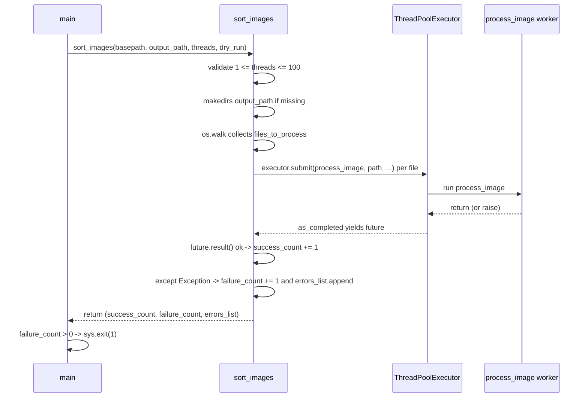

# Sorting Pipeline

One invocation of `sortinfolder.py` runs a single, fully parallel pipeline: discover every file under a source tree, fan the files out to worker threads, and let each worker independently resolve a date, create a destination folder, copy, rotate, and tag its file. The orchestration layer never touches image bytes — it only walks, submits, counts, and reports. This page traces that flow end to end: discovery, fan-out, the per-file steps of `process_image`, dry-run planning, and how failures roll up into the `(success_count, failure_count, errors_list)` result that `main()` turns into an exit code.

For the static layering of the three functions involved, see [Architecture Overview](../architecture/overview.md); the metadata mechanics each step relies on are detailed in [EXIF and Metadata](../concepts/exif-and-metadata.md); the CLI flags that parameterize the run are in [CLI and Configuration](../operations/cli-and-configuration.md).

## Stage 1 — orchestration setup and file discovery

`sort_images(basepath, output_path, threads=30, dry_run=False)` begins with three setup actions (`sortinfolder.py#L223-L249`):

1. **Validate `threads`.** `if not 1 <= threads <= 100: raise ValueError(...)` — the bound is enforced here, in the orchestration layer, not in the argument parser, so it also guards direct programmatic callers (`sortinfolder.py#L237`). `--threads 0` and `--threads 101` fail this way through the CLI, as `test_cli_invalid_threads_value` verifies end-to-end.
2. **Create the output root.** A missing `output_path` is created with `os.makedirs` before any work is submitted — this is the *only* filesystem mutation that dry-run still performs (see [Dry-run mode](#dry-run-mode)).
3. **Walk the source tree.** `for root, dirs, files in os.walk(basepath)` collects *every* file (any extension, any depth) into `files_to_process` via `os.path.join(root, file)`. Filtering by format happens later, per worker — so an unsupported file is *counted as a success* (its `process_image` call returns without doing anything), while a file whose EXIF cannot be read may become a counted failure. A nonexistent `basepath` makes `os.walk` yield nothing, producing a quiet empty run: 0 processed, exit 0.

Discovery collects files without checking `SUPPORTED_FORMATS`, which `process_image` then applies as its very first gate.

## Stage 2 — thread-pool fan-out

All discovered files are submitted in one shot to a `concurrent.futures.ThreadPoolExecutor` (`sortinfolder.py#L255-L257`):

```python
futures = {executor.submit(process_image, file_path, basepath, output_path, dry_run): file_path for file_path in files_to_process}
for future in concurrent.futures.as_completed(futures):
```

Each future is keyed by its `file_path`, which is how the completion loop maps a finished worker back to the file that failed. Default is 30 worker threads, configurable to any value from 1 to 100. There is no producer/consumer queue and no shared worker state: each `process_image` call is independent, opening and writing files on its own, and threads coordinate only through the filesystem. Note the progress-vs-failure nuance: `as_completed` yields futures in completion order, but `success_count`/`failure_count` count *submitted files*, not copies — an unsupported file bumps the success count without creating anything, and a worker that fails *after* copying (e.g. during rotation or tagging) is counted as a failure even though its copy already exists in the output tree.



*Caption: the orchestration loop — one future per discovered file, a per-file catch that converts worker exceptions into counted failures, and the aggregate result returned to `main()`, which exits 1 when anything failed.*

## Stage 3 — the per-file pipeline in `process_image`

`process_image(file_path, basepath, output_path, dry_run=False)` runs five steps in a fixed order (`sortinfolder.py#L156-L222`):

<!-- openwiki: mermaid parse failed and this diagram was converted to a text fence so it does not break rendering. Fix the diagram source and restore the mermaid fence. Parser error: Heuristic: an unescaped angle bracket inside a label breaks rendering; rephrase the label. -->
```text
flowchart TD
    A["process_image(file_path, basepath, output_path, dry_run)"] --> G{"ext lowercased in SUPPORTED_FORMATS?"}
    G -- "no" --> S["log debug 'Skipping unsupported format' and return"]
    G -- "yes" --> D["get_date_taken(file_path) on source"]
    D --> F["destination folder output/YYYY/MM/DD"]
    F --> MK{"dry_run or folder exists?"}
    MK -- "no" --> MKD["os.makedirs date folder"]
    MKD --> N
    MK -- "yes" --> N["pick basename in folder"]
    N --> C{"path exists?"}
    C -- "yes" --> SUF["append _1 _2 ... suffix and retry"]
    SUF --> C
    C -- "no" --> LOGC{"counter > 1?"}
    LOGC -- "yes" --> LOGCL["log info 'Filename collision detected'"]
    LOGCL --> DRYQ
    LOGC -- "no" --> DRYQ{"dry_run?"}
    DRYQ -- "yes" --> SIM["log Would copy / Would rotate / Would tag and return"]
    DRYQ -- "no" --> CP["shutil.copy2 file_path to new_file_path"]
    CP --> ROT["rotate_image_according_to_exif(new_file_path)"]
    ROT --> TAG["add_relative_path_tag(new_file_path, relative_path)"]
```

*Caption: the per-file pipeline — format gate, date resolution on the source, dated folder creation with collision suffixing, then (unless dry-run) copy first and rotate and tag the copy.*

1. **Format gate.** The extension is lowercased and checked against `SUPPORTED_FORMATS = {'.jpg', '.jpeg', '.png', '.heic', '.tiff', '.tif', '.bmp', '.webp'}`; anything else is logged at debug level and the function returns before any date lookup or copying. This is the single point of control for which formats the tool touches (`sortinfolder.py#L167-L170`).
2. **Date extraction (source file).** `get_date_taken(file_path)` runs against the *source*. It never raises for missing/malformed EXIF — it falls back to the file's ctime — so this step always yields a `datetime`, and the destination folder is `output/YYYY/MM/DD` via `date_taken.strftime("%Y/%m/%d")` (`sortinfolder.py#L177`). The two-step resolution chain is documented in [EXIF and Metadata](../concepts/exif-and-metadata.md).
3. **Folder creation.** `if not dry_run and not os.path.exists(new_folder): os.makedirs(new_folder)` — real runs create the date folder on first touch; dry-run skips creation entirely (`sortinfolder.py#L178-L181`). Workers race benignly here: `os.makedirs` is only called after an existence check, and the checked-then-created window is harmless in practice because a colliding worker either creates it first or finds it created.
4. **Collision handling.** The basename starts as the original name; while the target path exists in the folder, a `while os.path.exists(new_file_path)` loop appends `_1`, `_2`, … as `{name}_{counter}{ext}` and retries, so the first arrival in a date folder keeps its name and later arrivals get numeric suffixes (`sortinfolder.py#L184-L191`). Any collision (counter > 1) is logged at info level: `Filename collision detected for <base_name>, using <new_name>` (`sortinfolder.py#L192-L193`). Colliding copies are additive, never overwrites — two different files named `test.jpg` from `sub1/` and `sub2/` land as `test.jpg` and `test_1.jpg`, and re-running against a populated output tree also re-suffixes rather than overwrites. `test_process_image_handles_duplicate_filenames` pins this behavior: it asserts `test.jpg` and `test_1.jpg` both exist in `2024/06/15`, differ by MD5, and preserve their original red/blue pixel content (`test_sortinfolder.py#L24-L91`).
5. **Copy → rotate → tag (real runs only).** The mutation sequence is strictly ordered, and everything operates on the **destination copy**, never the source (`sortinfolder.py#L215-L221`):
   - `shutil.copy2(file_path, new_file_path)` — metadata-preserving copy; the source file is never modified or deleted, so the pipeline is idempotent-safe for the source tree.
   - `rotate_image_according_to_exif(new_file_path)` — the copied file is re-opened, and if the EXIF `Orientation` is 3, 6, or 8 it is rotated 180°, 270°, or 90° and saved back **to the copy in place**. Orientation values other than 3/6/8 (including absent) leave the copy untouched. Rotation happens *on the copied file*, not the original — the source's orientation tag is never rewritten.
   - `relative_path = os.path.relpath(os.path.dirname(file_path), basepath)` then `add_relative_path_tag(new_file_path, relative_path)` — the provenance tag uses the **source-relative directory path**, i.e. where the file lived under `basepath` (e.g. `sub2` for `sub2/test.jpg`), not the new destination path. It is appended to the copy's EXIF `UserComment` as `\nRelativePath:<path>`, and only for `.jpg`/`.jpeg` — other formats are copied and dated but never tagged.

The ordering matters: the copy is created first so the destination path exists, then rotation rewrites that copy, then tagging reads and rewrites the (already rotated) copy's EXIF — so both metadata edits survive into the final artifact. Rotation is skipped for truncated data or missing orientation (logged, not fatal to the file), but tagging still runs afterward; a hard rotation or tagging error (e.g. `UnidentifiedImageError` from a corrupted file, or a piexif failure) is raised out of `process_image` and handled by Stage 4.

## Dry-run mode

With `--dry-run` (or `dry_run=True` passed programmatically), `process_image` becomes a pure planning mode: it computes and logs everything a real run would do, then returns before any copy, rotation, or tagging (`sortinfolder.py#L197-L213`). `sort_images` announces the mode with the banner `DRY RUN MODE - Simulating processing without copying files` (`sortinfolder.py#L243-L244`).

What dry-run does and does not do:

- **No date folders are created.** The `os.makedirs(new_folder)` call is skipped — the destination is only computed and named in logs.
- **No files are copied.** Instead of `shutil.copy2`, the worker logs `DRY RUN: Would copy <file> to <new_file_path>` — including any `_N` collision suffix the existing output tree would force.
- **Rotation is only logged.** The worker opens the *source* read-only, reads the EXIF orientation, and logs `DRY RUN: Would rotate image <path> by <angle> degrees` (180 for orientation 3, 270 for 6, 90 for 8) or `DRY RUN: No rotation needed for <path>`. If the source cannot be opened (corrupt, unsupported by Pillow), it logs `DRY RUN: Could not check rotation for <file>` at warning level and *continues* — the dry-run probe failure is never a counted failure, unlike the same file in a real run.
- **Tagging is only logged.** For `.jpg`/`.jpeg` targets it logs `DRY RUN: Would add RelativePath tag: RelativePath:<value> to <path>`; for other formats, `DRY RUN: Would skip tag for <path> (format not supported for tagging)`.
- **The output root may still be created** by `sort_images`' unconditional `os.makedirs(output_path)` — the only filesystem side effect dry-run retains. Dry-run is therefore safe to point at a real output directory used by previous real runs; it adds nothing, copies nothing, and modifies nothing below the root.

`test_cli_threads_and_dry_run` verifies the contract end-to-end: with `--threads 5 --dry-run` the CLI exits 0, output contains `DRY RUN` plus the target date folder `2024/06/15` and filename `test.jpg`, and the output directory contains **zero files** (`test_sortinfolder.py#L167-L218`).

## Stage 4 — completion handling, error collection, and the result tuple

As each future completes, `sort_images` resolves it and classifies the outcome (`sortinfolder.py#L257-L269`):

```python
for future in concurrent.futures.as_completed(futures):
    file_path = futures[future]
    try:
        future.result()
        success_count += 1
    except Exception as e:  # noqa: BLE001 - Catch all exceptions from worker threads to collect errors
        failure_count += 1
        error_info = {
            "file": file_path,
            "type": type(e).__name__,
            "message": str(e)
        }
        errors_list.append(error_info)
        logger.error(f"Failed to process {file_path}: {type(e).__name__}: {e}")
```

The bare `except Exception` is a deliberate catch-all: any exception escaping a worker thread — an undecodable image, an unreadable file, a `struct.error` from piexif, anything — is converted into a structured failure record instead of crashing the run. The record has exactly three keys: `file` (the source path from the future map), `type` (the exception class name), and `message` (`str(e)`). Failures are therefore isolated per file: one corrupted file never aborts the rest of the run, and sibling futures keep processing.

After all futures complete, the summary line `Processed: N, Succeeded: N, Failed: N` is logged (where `Processed` is the sum of both counts) and `sort_images` returns `(success_count, failure_count, errors_list)` (`sortinfolder.py#L272-L275`). `test_error_summary_and_exit_code` asserts this precisely with one valid and one corrupted file: a 3-tuple with counts `1, 1`, one error dict carrying `file`/`type`/`message` and referencing `corrupted.jpg`, the summary `Processed: 2, Succeeded: 1, Failed: 1`, and the valid image still copied to `2024/06/15` (`test_sortinfolder.py#L247-L322`).

## Final stage — exit code

`main()` unpacks the tuple and applies one aggregate rule: `if failure_count > 0: sys.exit(1)` (`sortinfolder.py#L313-L314`). A run with zero worker failures falls through `main()` and exits 0; a run with *any* failure exits 1, regardless of how many files succeeded. `test_cli_exit_code_end_to_end` proves both branches through real subprocesses: one valid + one corrupted file → exit 1 with `Failed: 1` / `Processed: 2` in the output; only valid files → exit 0 with `Failed: 0` / `Processed: 1` (`test_sortinfolder.py#L325-L393`). Together with the unit test this covers the full chain: worker exception → per-file catch in `sort_images` → failure count → exit 1.

Note the asymmetry with dry-run: the same corrupted file that merely logs a warning during the dry-run rotation probe becomes a counted failure in a real run, because in a real run the copy succeeds but rotation (`UnidentifiedImageError`) or date/tagging work raises into the catch-all.

## Run lifecycle summary

| Stage | Owner | Filesystem effect |
| --- | --- | --- |
| Validate threads | `sort_images` | none (raises `ValueError` if out of 1–100) |
| Create output root | `sort_images` | creates `output_path` if missing (also in dry-run) |
| Discover files | `sort_images` via `os.walk` | none |
| Fan out futures | `sort_images` via `executor.submit` | none |
| Per-file work | `process_image` per worker | creates date folder, copies file, rotates and tags the copy (real run only) |
| Collect results | `sort_images` completion loop | none |
| Report and exit | `sort_images` summary log, then `main()` | none |

## Invariants

- **Source immutability.** The source tree is never mutated: date reads are read-only, and rotation/tagging rewrite only `new_file_path`, the freshly copied file. A run can be repeated against the same source without changing any source file (re-running against a populated output tree re-copies with `_N` suffixes rather than overwriting).
- **Every discovered file is counted.** `success_count + failure_count == len(files_to_process)`; unsupported formats count as successes, worker exceptions as failures. Nothing is silently dropped from the accounting.
- **Errors never abort the run.** Per-file isolation via the catch-all `except Exception`; the summary line and `(success, failure, errors)` tuple are always produced.
- **Exit code reflects the aggregate.** Exit 1 iff at least one submitted file raised in its worker thread; otherwise exit 0. Dry-run runs exit 0 (probe failures are warnings, not failures).
- **Distinct files never overwrite each other.** Within a date folder, `_1`, `_2`, … suffixes guarantee that same-named files from different source directories coexist with their original content.
- **Rotation precedes tagging, both on the copy.** The final artifact's EXIF block carries both the rotation rewrite and the appended `RelativePath:` provenance line; the tag value is the file's source-relative directory, not its destination.
